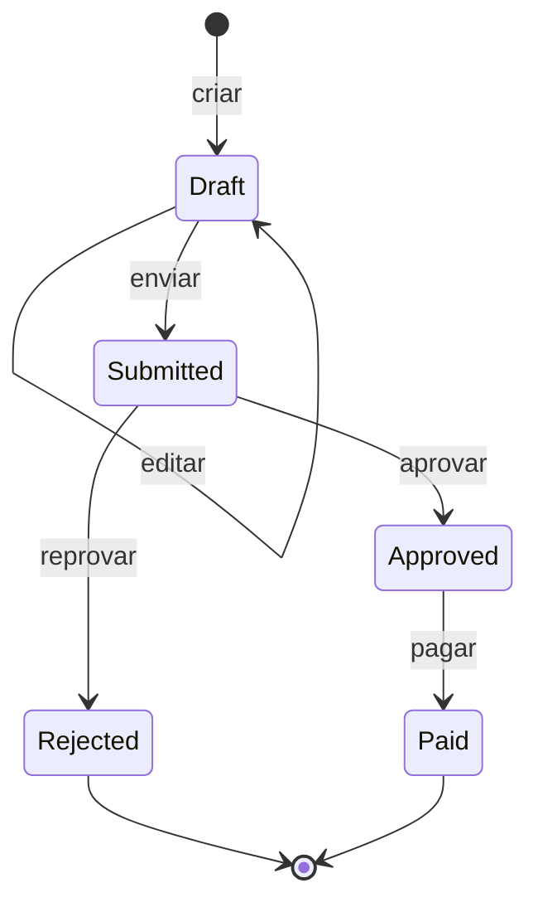

# ExpenseHub

API REST corporativa de **reembolsos de despesas**, desenvolvida em C# com ASP.NET Core para o Checkpoint 2 de C# (FIAP).

Funcionários registram despesas, aprovadores analisam os pedidos, o financeiro registra o pagamento (simulado) e auditores consultam todo o histórico. Cada operação é protegida considerando **identidade autenticada, perfil (role), proprietário do reembolso, estado atual e regra de transição**.

## Sumário

- [Funcionalidades](#funcionalidades)
- [Tecnologias](#tecnologias)
- [Perfis e permissões](#perfis-e-permissões)
- [Ciclo de vida do reembolso](#ciclo-de-vida-do-reembolso)
- [Arquitetura e estrutura do projeto](#arquitetura-e-estrutura-do-projeto)
- [Pré-requisitos](#pré-requisitos)
- [Instalação e configuração](#instalação-e-configuração)
- [Banco de dados](#banco-de-dados)
- [Como executar](#como-executar)
- [Endpoints](#endpoints)
- [Fluxo para testar a API](#fluxo-para-testar-a-api)
- [Contratos de entrada](#contratos-de-entrada)
- [Autenticação e autorização](#autenticação-e-autorização)
- [Decisões de comportamento](#decisões-de-comportamento)
- [Testes unitários](#testes-unitários)
- [Qualidade de código e CI](#qualidade-de-código-e-ci)
- [Integrantes](#integrantes)

## Funcionalidades

- Cadastro e login de usuários com **JWT (bearer)**.
- Administração de roles por um usuário `Admin`.
- Criação, edição e envio de reembolsos (rascunho → enviado).
- Aprovação e reprovação (com justificativa) por aprovadores.
- Pagamento simulado pelo financeiro, com registro de pagamento.
- **Histórico completo** de cada reembolso (ação, ator, horário UTC, estados, justificativa e campos alterados).
- Visibilidade filtrada por perfil, aplicada na consulta ao banco.
- Controle de **concorrência otimista**: duas alterações simultâneas no mesmo reembolso resultam em `409`.
- Respostas de erro padronizadas em `ProblemDetails`.

## Tecnologias

| Item | Tecnologia |
|---|---|
| Linguagem / plataforma | C# / .NET 10 (`net10.0`) |
| Framework web | ASP.NET Core (Minimal APIs) |
| Autenticação | JWT Bearer (`Microsoft.AspNetCore.Authentication.JwtBearer` 10.0.12) |
| Identidade e roles | ASP.NET Core Identity (`Microsoft.AspNetCore.Identity.EntityFrameworkCore` 10.0.12) |
| Acesso a dados | Entity Framework Core com SQLite (`Microsoft.EntityFrameworkCore.Sqlite` 10.0.12) |
| Documentação da API | OpenAPI (`Microsoft.AspNetCore.OpenApi` 10.0.12) |
| Testes | MSTest 4.0.2 |
| Análise estática | Analisadores .NET e StyleCop.Analyzers 1.1.118 |
| CI | GitHub Actions + Gitleaks |

## Perfis e permissões

| Role | Responsabilidade |
|---|---|
| `Employee` | Criar, editar, enviar e consultar os próprios reembolsos |
| `Approver` | Consultar reembolsos enviados e aprovar ou reprovar os que não são seus |
| `Finance` | Consultar reembolsos aprovados/pagos e registrar pagamento dos que não são seus |
| `Auditor` | Consultar todos os reembolsos e históricos, sem escrita |
| `Admin` | Listar usuários e administrar roles |

Regras gerais:

- As roles **acumulam permissões** (o usuário recebe a união das permissões), mas **ninguém aprova ou paga o próprio reembolso**.
- Ser `Admin` **não** concede acesso funcional a reembolsos. Para operar reembolsos, o Admin precisa também de outra role.
- Um usuário recém-cadastrado nasce **sem nenhuma role**.

Matriz resumida (`*` = depende também de ownership, estado ou visibilidade):

| Operação | Employee | Approver | Finance | Auditor | Admin |
|---|:---:|:---:|:---:|:---:|:---:|
| Registrar / Login | público | público | público | público | público |
| Listar usuários e alterar roles | não | não | não | não | sim |
| Criar, editar e enviar reembolso | sim* | não | não | não | não |
| Listar / consultar detalhe | próprios | `Submitted` | `Approved`/`Paid` | todos | não |
| Aprovar / reprovar | não | sim* | não | não | não |
| Pagar | não | não | sim* | não | não |
| Consultar histórico | próprio | visível | visível | todos | não |

A matriz completa está em [docs/MATRIZ-AUTORIZACAO.md](docs/MATRIZ-AUTORIZACAO.md).

## Ciclo de vida do reembolso



| Estado atual | Ação | Quem pode | Próximo estado |
|---|---|---|---|
| inexistente | criar | `Employee` | `Draft` |
| `Draft` | editar | proprietário | `Draft` |
| `Draft` | enviar | proprietário | `Submitted` |
| `Submitted` | aprovar | `Approver`, exceto o proprietário | `Approved` |
| `Submitted` | reprovar | `Approver`, exceto o proprietário | `Rejected` |
| `Approved` | pagar | `Finance`, exceto o proprietário | `Paid` |

- `Rejected` e `Paid` são **estados finais**.
- Não existem reabertura, cancelamento, exclusão ou reenvio.
- Repetir uma transição retorna `409` e **não** cria histórico duplicado.
- O estado é definido **exclusivamente pelo servidor**: não existe endpoint genérico que altere o estado.

## Arquitetura e estrutura do projeto

```text
.
├── .github/
│   └── workflows/build.yml
├── docs/
├── scripts/
│   └── Invoke-CodeQuality.ps1
├── tests/
├── sources/
│   ├── ExpenseHub.slnx
│   ├── ExpenseHub.Api/
│   │   ├── Application/
│   │   ├── Configuration/
│   │   ├── Data/
│   │   ├── Domain/
│   │   ├── Dtos/
│   │   ├── Endpoints/
│   │   ├── Responses/
│   │   ├── Security/
│   │   ├── appsettings.json
│   │   └── Program.cs
│   └── ExpenseHub.UnitTests/
│       ├── Domain/
│       ├── Expenses/
│       ├── Fakes/
│       └── Security/
├── Directory.Build.props
└── README.md
```

| Pasta | Responsabilidade |
|---|---|
| `Endpoints/` | Mapeamento das rotas HTTP, validação de entrada e conversão de falhas em `ProblemDetails` |
| `Application/` | Serviços e regras de negócio (`ExpenseService`, `AuthService`, `AdminUserService`, visibilidade e regras de validação) |
| `Domain/` | Entidades (`Expense`, `ExpenseCategory`, `ExpenseHistory`, `PaymentRecord`), estados, ações e máquina de estados |
| `Data/` | `DbContext`, mapeamentos EF Core, repositório e inicialização do banco (seed) |
| `Security/` | Roles, políticas de autorização, emissão e validação de JWT, usuário corrente |
| `Dtos/` e `Responses/` | Contratos de entrada e saída da API (entidades nunca são expostas diretamente) |
| `Configuration/` | Registro de serviços (Identity, JWT, autorização, EF Core) |

Fluxo de uma requisição: o endpoint aplica a **política por role** e valida o corpo; o **serviço** completa a autorização com ownership, estado e visibilidade; a **entidade de domínio** aplica a transição pela máquina de estados e gera o histórico; o **repositório** persiste a alteração e o histórico na mesma transação.

## Pré-requisitos

- [.NET SDK 10.0](https://dotnet.microsoft.com/download) ou superior
- Git
- (Opcional) PowerShell 7+ (`pwsh`) para executar o script de qualidade localmente
- (Opcional) `curl` ou um cliente HTTP (Postman, Insomnia, extensão REST Client) para testar a API

Verifique a instalação do SDK:

```shell
dotnet --version
```

## Instalação e configuração

### 1. Clonar o repositório

```shell
git clone https://github.com/glunghini/CP2-C-.git
cd CP2-C-
```

### 2. Configurar segredos (obrigatório, fora do código)

A senha do Admin e a chave de assinatura do JWT **não ficam no repositório**. Configure por variável de ambiente antes de executar.

PowerShell (Windows):

```powershell
$env:AdminSeed__Password = "<senha-do-admin>"
$env:Jwt__SigningKey = "<chave-com-32-caracteres-ou-mais>"
```

Bash (Linux/macOS):

```bash
export AdminSeed__Password='<senha-do-admin>'
export Jwt__SigningKey='<chave-com-32-caracteres-ou-mais>'
```

Alternativa: criar o arquivo `sources/ExpenseHub.Api/appsettings.Development.json` (já ignorado pelo Git) com as mesmas chaves:

```json
{
  "AdminSeed": {
    "Password": "<senha-do-admin>"
  },
  "Jwt": {
    "SigningKey": "<chave-com-32-caracteres-ou-mais>"
  }
}
```

| Configuração | Padrão | Observações |
|---|---|---|
| `AdminSeed:Email` | `admin@expensehub.local` | E-mail do Admin inicial (definido em `appsettings.json`) |
| `AdminSeed:Password` | não definida | Sem ela a aplicação sobe, mas **não cria o Admin** (aparece um aviso no log) |
| `Jwt:SigningKey` | gerada em memória | Sem ela, uma chave temporária é gerada e os tokens deixam de valer quando a aplicação reinicia |
| `Jwt:Issuer` | `ExpenseHub` | Emissor do token |
| `Jwt:Audience` | `ExpenseHub.Clients` | Público do token |
| `Jwt:ExpirationMinutes` | `60` | Validade do token em minutos |
| `ConnectionStrings:ExpenseHub` | `Data Source=expensehub.db` | Connection string do SQLite |

A senha do Admin precisa seguir a política do Identity: **8 ou mais caracteres, com letra maiúscula, minúscula, número e símbolo**. A chave do JWT deve ter **no mínimo 32 caracteres**.

> Nunca versione senhas, tokens ou chaves. O `.gitignore` já ignora `appsettings.Development.json`, `appsettings.Local.json`, `*.env` e `*.db`.

## Banco de dados

- **Provider:** SQLite, pacote `Microsoft.EntityFrameworkCore.Sqlite` 10.0.12.
- **Connection string:** `appsettings.json` → `ConnectionStrings:ExpenseHub` = `Data Source=expensehub.db`.
- **Criação:** o banco é criado automaticamente na inicialização (`EnsureCreated`), junto com as roles e as categorias. Não há migrations nem comando extra a executar.
- **Recriar do zero:** apague o arquivo `expensehub.db` e execute a aplicação novamente.
- Arquivos `*.db` estão no `.gitignore`.

O que é criado na inicialização (idempotente, pode rodar várias vezes):

- As roles `Admin`, `Employee`, `Approver`, `Finance` e `Auditor`.
- As categorias de despesa: `1` Alimentação, `2` Transporte, `3` Hospedagem, `4` Material de escritório, `5` Outros.
- **Uma única** conta Admin (`AdminSeed:Email`), vinculada à role `Admin`. Nenhum outro usuário é criado pelo seed.

Entidades persistidas: `Expense`, `ExpenseCategory`, `ExpenseHistory`, `PaymentRecord` e as tabelas do ASP.NET Core Identity.

## Como executar

```shell
dotnet restore ./sources/ExpenseHub.slnx
dotnet build ./sources/ExpenseHub.slnx
dotnet test ./sources/ExpenseHub.slnx
dotnet run --project ./sources/ExpenseHub.Api/ExpenseHub.Api.csproj
```

- A API sobe em **`http://localhost:5245`** (perfil `http`, ambiente `Development`).
- O documento OpenAPI fica em **`/openapi/v1.json`** (somente em `Development`).
- `GET /health` retorna `{ "status": "ok" }` e confirma que a aplicação iniciou.

## Endpoints

| Método e rota | Operação | Acesso |
|---|---|---|
| `GET /health` | Verificação de saúde | Público |
| `POST /register` | Registrar usuário (sem role) | Público |
| `POST /login` | Autenticar e obter o token | Público |
| `GET /api/admin/users` | Listar usuários e suas roles | `Admin` |
| `PUT /api/admin/users/{id}/roles` | Substituir as roles de um usuário | `Admin` |
| `GET /api/expense-categories` | Listar categorias | `Employee`, `Approver`, `Finance` ou `Auditor` |
| `POST /api/expenses` | Criar rascunho | `Employee` |
| `PUT /api/expenses/{id}` | Editar rascunho próprio | `Employee` (proprietário, `Draft`) |
| `GET /api/expenses` | Listar conforme o perfil | `Employee`, `Approver`, `Finance` ou `Auditor` |
| `GET /api/expenses/{id}` | Consultar detalhe visível | `Employee`, `Approver`, `Finance` ou `Auditor` |
| `POST /api/expenses/{id}/submit` | Enviar rascunho | `Employee` (proprietário, `Draft`) |
| `POST /api/expenses/{id}/approve` | Aprovar | `Approver` (`Submitted`, não proprietário) |
| `POST /api/expenses/{id}/reject` | Reprovar com justificativa | `Approver` (`Submitted`, não proprietário) |
| `POST /api/expenses/{id}/pay` | Registrar pagamento | `Finance` (`Approved`, não proprietário) |
| `GET /api/expenses/{id}/history` | Consultar histórico | Mesma visibilidade do reembolso |

Os identificadores de reembolso são `GUID`. Os estados são serializados como texto (`Draft`, `Submitted`, `Approved`, `Rejected`, `Paid`).

## Fluxo para testar a API

1. `POST /login` com o Admin → copiar o `accessToken`.
2. `POST /register` com `{ "email": "...", "password": "..." }`. O usuário nasce **sem role**; enviar `roles` no corpo retorna `400`.
3. `GET /api/admin/users` (Admin) → pegar o `id` do usuário.
4. `PUT /api/admin/users/{id}/roles` com `{ "roles": ["Employee"] }`. A lista é **completa** e substitui as roles atuais.
5. O usuário faz `POST /login` novamente (depois de mudar roles, o token antigo deixa de valer).
6. Enviar o token no header `Authorization: Bearer <token>`.

### Exemplo com curl

Login do Admin:

```bash
curl -s -X POST http://localhost:5245/login \
  -H "Content-Type: application/json" \
  -d '{"email":"admin@expensehub.local","password":"<senha-do-admin>"}'
```

Registrar um funcionário:

```bash
curl -s -X POST http://localhost:5245/register \
  -H "Content-Type: application/json" \
  -d '{"email":"funcionario@empresa.com","password":"Senha@123"}'
```

Atribuir a role `Employee` (usando o token do Admin):

```bash
curl -s -X PUT http://localhost:5245/api/admin/users/<id-do-usuario>/roles \
  -H "Authorization: Bearer <token-do-admin>" \
  -H "Content-Type: application/json" \
  -d '{"roles":["Employee"]}'
```

Criar um reembolso (usando o token do funcionário, após novo login):

```bash
curl -s -X POST http://localhost:5245/api/expenses \
  -H "Authorization: Bearer <token-do-funcionario>" \
  -H "Content-Type: application/json" \
  -d '{"description":"Almoco com cliente","amount":85.50,"expenseDate":"2026-10-10","categoryId":1}'
```

Enviar para aprovação:

```bash
curl -s -X POST http://localhost:5245/api/expenses/<id-do-reembolso>/submit \
  -H "Authorization: Bearer <token-do-funcionario>"
```

Aprovar (usuário diferente, com a role `Approver`):

```bash
curl -s -X POST http://localhost:5245/api/expenses/<id-do-reembolso>/approve \
  -H "Authorization: Bearer <token-do-aprovador>"
```

Pagar (usuário diferente, com a role `Finance`):

```bash
curl -s -X POST http://localhost:5245/api/expenses/<id-do-reembolso>/pay \
  -H "Authorization: Bearer <token-do-financeiro>"
```

Consultar o histórico:

```bash
curl -s http://localhost:5245/api/expenses/<id-do-reembolso>/history \
  -H "Authorization: Bearer <token-do-funcionario>"
```

## Contratos de entrada

Criar/editar reembolso (`POST /api/expenses` e `PUT /api/expenses/{id}`):

```json
{
  "description": "Almoco com cliente",
  "amount": 85.50,
  "expenseDate": "2026-10-10",
  "categoryId": 1
}
```

Reprovar reembolso (`POST /api/expenses/{id}/reject`):

```json
{
  "justification": "Nota fiscal ilegivel."
}
```

Alterar roles (`PUT /api/admin/users/{id}/roles`):

```json
{
  "roles": ["Employee", "Approver"]
}
```

Registro e login (`POST /register`, `POST /login`):

```json
{
  "email": "usuario@empresa.com",
  "password": "Senha@123"
}
```

Resposta do login:

```json
{
  "accessToken": "<jwt>",
  "tokenType": "Bearer",
  "expiresAtUtc": "2026-10-13T23:00:00Z"
}
```

### Validações

| Campo | Regra |
|---|---|
| `description` | Obrigatória, entre 10 e 500 caracteres |
| `amount` | Entre R$ 0,01 e R$ 2.147.483.647,00 (`decimal`) |
| `expenseDate` | Data válida e **não futura** |
| `categoryId` | Obrigatório e existente |
| `justification` | Obrigatória na reprovação, entre 10 e 500 caracteres |
| `email` | Obrigatório, formato válido, até 256 caracteres; deve ser único |
| `password` (registro) | Entre 8 e 100 caracteres, com maiúscula, minúscula, número e símbolo |
| `roles` | Lista obrigatória (pode ser vazia), no máximo 5 itens, apenas roles conhecidas |

Campos que **não** fazem parte do contrato (`ownerId`, `status`, datas, atores) são **rejeitados com `400`**. Proprietário, estado, atores e horários são sempre derivados da identidade autenticada e do servidor.

## Autenticação e autorização

- **Autenticação:** JWT Bearer assinado com chave simétrica. Validade padrão de 60 minutos, com tolerância de 30 segundos de relógio.
- **Autorização em duas camadas:**
  1. *Política por role* aplicada na rota (`AdminOnly`, `EmployeeOnly`, `ApproverOnly`, `FinanceOnly`, `ExpenseReader`).
  2. *Regras contextuais* no serviço: ownership, estado atual e visibilidade do recurso.
- **Invalidação após mudança de roles:** o token carrega o *security stamp* do usuário. Ao alterar roles, o stamp muda e os tokens antigos deixam de valer, exigindo novo login.
- **Bloqueio de conta:** 5 tentativas de login inválidas bloqueiam a conta por 5 minutos.
- **Senhas:** nunca armazenadas em texto puro (o Identity persiste apenas o hash).
- **Filtro na consulta:** a visibilidade é aplicada **antes** de materializar os dados, sem carregar tudo em memória para filtrar depois.
- **Nunca se confia no cliente** para `userId`, role, estado, ator ou timestamp.

## Decisões de comportamento

### Respostas HTTP

Os erros usam `ProblemDetails`:

| Status | Quando |
|---|---|
| `400 Bad Request` | Entrada inválida (inclui campos não previstos no contrato) |
| `401 Unauthorized` | Sem token ou token inválido/expirado |
| `403 Forbidden` | Autenticado, mas sem permissão para a operação |
| `404 Not Found` | Recurso inexistente ou fora do escopo de leitura do usuário |
| `409 Conflict` | Transição inválida ou repetida, ou conflito de concorrência |

### Visibilidade

| Perfil | O que enxerga |
|---|---|
| `Employee` | Os próprios reembolsos |
| `Approver` | Reembolsos em `Submitted` |
| `Finance` | Reembolsos em `Approved` e `Paid` |
| `Auditor` | Todos os reembolsos |
| `Admin` (sem outra role) | Nenhum reembolso |

### Regras de negócio

- Aprovar, reprovar ou pagar o **próprio** reembolso retorna `403`.
- Rascunho de outra pessoa retorna `404` (não revela que existe).
- Reembolso já enviado, em estado errado para a ação, retorna `409`.
- Admin tentando remover a **própria** role `Admin` retorna `409`.
- O pagamento é **simulado**: gera um `PaymentRecord` com valor, usuário do financeiro e horário UTC do servidor.

### Histórico

Cada ação grava um registro com: **ação, reembolso, ator, horário UTC, estado anterior, estado posterior, justificativa** (na reprovação) e **campos alterados** (enquanto o reembolso está em `Draft`, com valor anterior e novo). O histórico é gravado **na mesma transação** da alteração. Editar sem mudar nenhum campo não gera registro.

### Concorrência

Cada reembolso possui um token de versão (`Version`). Se duas alterações simultâneas atingirem o mesmo reembolso, a segunda recebe `409` e seu histórico é descartado.

## Testes unitários

Os testes ficam em `sources/ExpenseHub.UnitTests`, usam **MSTest** e executam **sem banco, rede ou serviço externo** (repositório em memória, relógio fixo e usuários de teste em `Fakes/`).

```shell
dotnet test ./sources/ExpenseHub.slnx
```

Cobertura por área:

| Área | O que é validado |
|---|---|
| `Domain/ExpenseStateMachineTests` e `ExpenseTests` | Transições permitidas e proibidas, estados finais, histórico gerado por cada ação |
| `Expenses/ExpenseServiceTests` | Fluxo completo: criar, editar, enviar, aprovar, reprovar, pagar, listar, histórico, ownership, roles, `404`/`403`/`409` e falha de concorrência |
| `Expenses/ExpenseRulesTests` | Validação de descrição, valor, data e justificativa |
| `Expenses/ExpenseVisibilityTests` | Escopo de leitura de cada perfil |
| `Security/RoleChangeRulesTests` | Regras de alteração de roles (inclui a trava do Admin) |
| `Security/CurrentUserTests` | Criação do usuário corrente a partir das claims do token |

## Qualidade de código e CI

- O projeto usa `Nullable` habilitado, analisadores .NET (`AnalysisMode=Recommended`), StyleCop.Analyzers, documentação XML e regras do `.editorconfig` aplicadas no build (configuradas em `Directory.Build.props`).
- O workflow `.github/workflows/build.yml` (**code-quality**) roda a cada push e pull request: instala o .NET e o Gitleaks, executa os testes do script de qualidade e roda `scripts/Invoke-CodeQuality.ps1 -Ci`, publicando o relatório como artefato.
- Para rodar a análise localmente (requer PowerShell 7+ e, para varredura de segredos, o Gitleaks):

```powershell
./scripts/Invoke-CodeQuality.ps1
```

## Integrantes

| Nome | GitHub | RM
|---|---|---|
| `Guilherme Lunghini Teixeira` | `glunghini` | `RM 556892` |
| `Marchel Augusto Ribeiro de Matos` | `Chel2815` | `RM 99856` |
